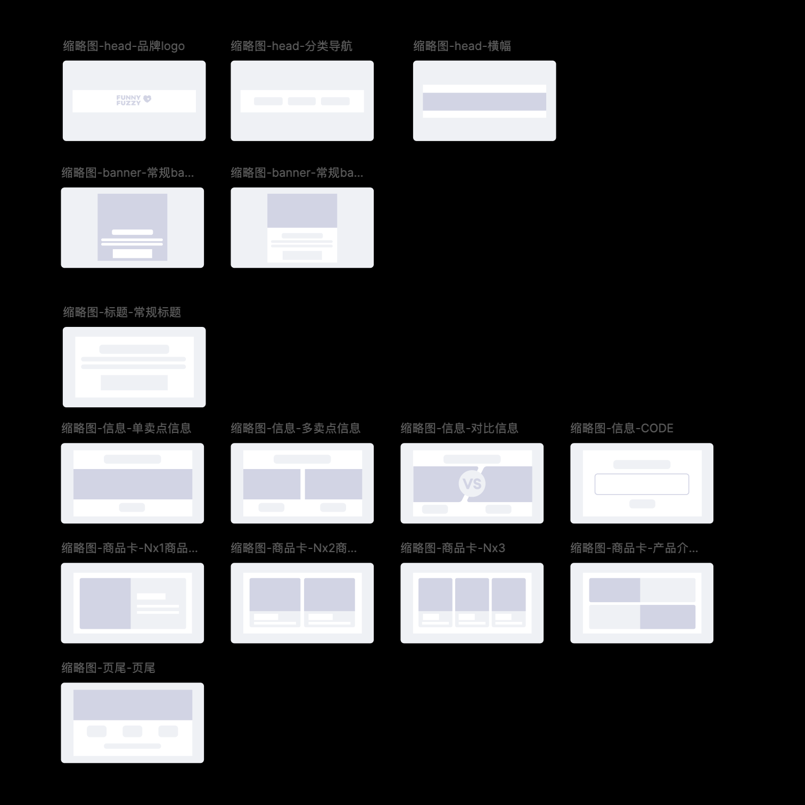
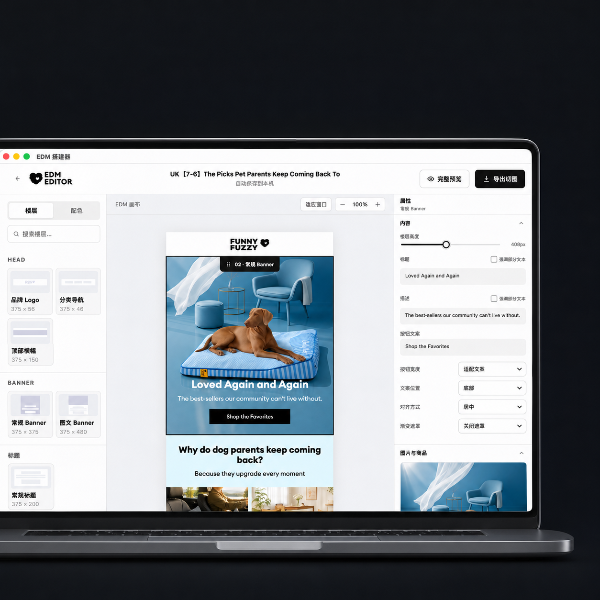
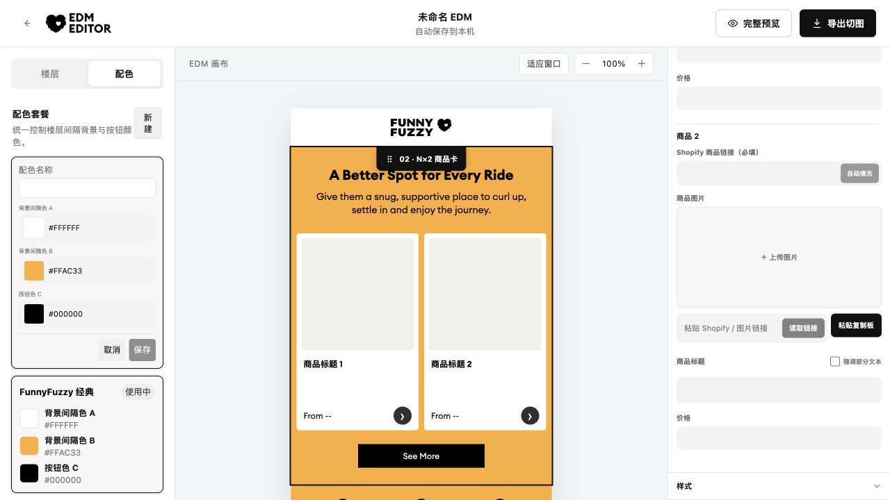
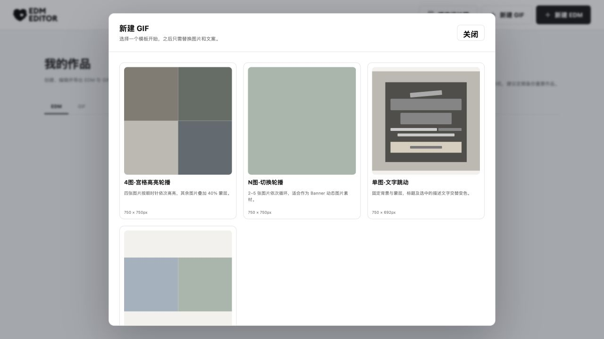
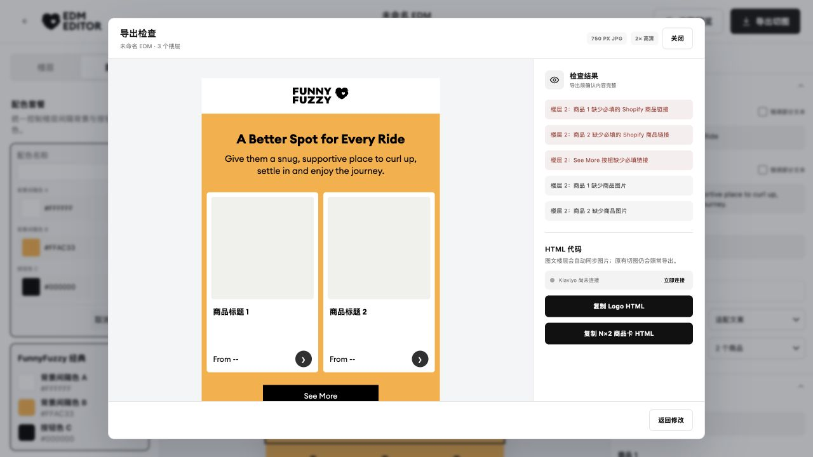

# EDM Editor

让运营从复制一个商品地址开始，自主完成营销邮件的内容、配色与交付，让设计师把精力留给规范和新的设计问题。

个人项目 · 产品、设计、开发 · 构思、交互、视觉、落地


## 为什么制作这个工具

日常 EDM 的高频变化主要来自商品、价格、图片和活动颜色，而不是版式创新。工具将稳定的设计判断沉淀为模板，缩短跨工具搬运信息的步骤。

原流程：运营提出需求 → 设计师制作 → 双方多轮修改 → 校对与切图 → 运营逐张上传至 Klaviyo、配置链接并发布。每次调整都可能重新交接。

新流程：运营在模板内搭建、配色和编辑内容 → 通过 Shopify 链接带入商品 → 检查图片与链接 → 同步图片并复制 HTML → 在 Klaviyo 自定义模块预览和发布。需要专门图片时，设计师按需参与。

## 重新分配设计师与运营之间的工作

- **减少重复制作**：同版式的替图、改字和价格调整由运营直接完成，设计师专注新模板与关键视觉判断。
- **约束制作规范**：模板锁定结构、字号、间距、图片比例和导出边界，在规范内保留调整空间。
- **内容由运营负责**：最了解活动信息的人直接编辑文字与价格，减少代录、校对和往返修改。
- **颜色由运营选择**：设计师提供推荐配色与安全范围，运营按活动需要组合与调整。
- **自动取数，代码交付**：商品链接带入标题、价格、主图和图库；支持的楼层生成 HTML，并通过 Klaviyo API 同步所需图片。

## 设计与功能

### 模板搭建与配色

Logo、导航、Banner、标题、商品卡和页尾以楼层复用；注册表、字段 schema 和导出区域共同描述模板。可编辑内容由模板明确约束。



A、B、C 色位管理间隔背景与按钮色。提供 FunnyFuzzy 经典、夏日、秋日暖棕、森林漫步等推荐组合，也支持编辑、复制、保存运营配色和单楼层自定义颜色。



### 商品信息自动填录

粘贴 Shopify 商品链接，自动读取标题、价格、主图和图库。运营仍可选图、裁切图片、修改文案及价格，覆盖读取结果。



### GIF 制作

提供宫格高亮轮播、图片切换轮播、文字跳动、左右轮播四类模板。GIF 可直接导出，或引用至邮件 Banner。



### 设计稿传递

单个设计稿可保存为 `.edm` 文件，在另一台电脑导入后继续编辑。Shopify 图片保留远程链接，减小传递文件体积；这些图片仍需要可访问的来源。

### 导出与发布

导出前检查必填图片与链接。图片路径下载楼层切图、完整长图和链接清单；多热区楼层拆分切图，便于分别配置跳转。代码路径支持逐楼层复制邮件 HTML。

配置 Klaviyo 后，复制支持楼层的 HTML 时，工具先同步所需图片，再复制代码。将代码粘贴至邮件自定义 HTML 模块，预览确认后发布；工具不自动发送营销邮件。



## 使用反馈与后续优化

作品集记录的反馈：EDM 设计需求量减少 **70%**，从需求到发布的时间缩短 **约 75%**。这些数字来自项目使用反馈，不是受控实验或仓库自动测量结果。

后续按同模板需求单数量、标准 EDM 真实制作时长，以及文字、价格、图片、颜色修改的往返轮次持续记录。设计师维护和扩展模板，运营尝试不同视觉风格与商品组合，再以投递反馈推动下一轮优化。

## 在电脑上安装

### 桌面版（无需安装 Node.js）

到 [Releases](https://github.com/xiemingjian2024-stack/ff-edm-editor/releases) 下载与系统匹配的版本。请以发布说明列出的系统和芯片为准；历史 Windows 包不代表当前源码版本。

**macOS**：下载 Mac 压缩包并完整解压，将 `EDM EDITOR.app` 放入“应用程序”，双击启动。Apple Silicon 使用 arm64 版本。若系统提示无法验证开发者，请在确认来源后按 macOS 的“隐私与安全性”提示允许打开。

**Windows**：下载 Windows 压缩包，完整解压到固定文件夹，双击 `EDM EDITOR.exe`。不要只单独移动 exe，应用依赖同目录文件。

**升级与草稿**：升级前退出应用，建议先将重要作品导出为 `.edm` 文件。仅替换程序，保留应用数据目录。草稿、GIF 和配色保存在本机，不会自动云端同步；清理应用数据可能删除草稿。

### Klaviyo 连接与 HTML 使用

1. 在 Klaviyo 账号中准备具有 Images 读取、写入权限的 Private API Key。
2. 在应用首页打开“设置 → Klaviyo 连接”，输入密钥并连接。不要把密钥写入源码或提交到 GitHub。
3. 完成邮件内容，进入导出窗口，点击支持楼层的“复制 HTML”。
4. 等待图片同步完成，将代码粘贴至 Klaviyo 自定义 HTML 模块，检查预览、链接和移动端效果。

图片切图本身不携带可点击链接，使用图片路径时请按链接清单在邮件平台配置。

### 从源码运行

需要与当前 Vite / Electron 依赖兼容的 Node.js（建议 Node.js 22.12 或更新的受支持版本）及 npm。

```sh
git clone https://github.com/xiemingjian2024-stack/ff-edm-editor.git
cd ff-edm-editor
npm ci
npm run build
npm start
```

按终端提示访问本机地址。桌面开发启动使用 `npm run desktop`。macOS 打包使用 `node scripts/package-desktop.mjs darwin arm64`；Windows 打包使用 `npm run package:desktop:win`。

```sh
npm test
npm run typecheck
npm run build
```

项目使用 React、TypeScript、Vite、Electron、IndexedDB 和本机服务。没有账号、云端草稿同步或多人实时协作。品牌资产、商品图片及第三方素材的权利归各自权利人所有；仓库公开不代表第三方资产可任意复用。
